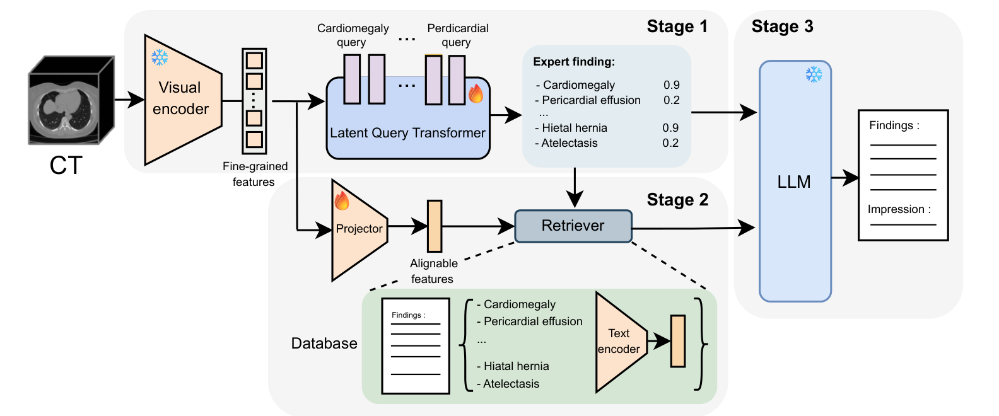

# Generating Reports or Repeating Templates? Measuring and Mitigating Template Collapse in 3D CT Report Generation

[](https://arxiv.org/abs/2605.30984)

Official implementation of the paper - **CLarGen**: Generating Reports or Repeating Templates? Measuring and Mitigating Template Collapse in 3D CT Report Generation - accepted at [EMNLP 2026](https://2026.emnlp.org/).

### News
🎉 CLarGen has been accepted at EMNLP 2026!

<p align="center">
  
</p>

3D medical vision-language models can write fluent radiology reports while collapsing onto a few generic
templates that miss patient-specific findings (**Template Collapse**). CLarGen separates *what to say* from
*how to say it*:

1. **Stage 1 - clinical perception.** A detection head trained with a focal loss predicts 18 thoracic
   findings from frozen [HLIP](https://github.com/Zch0414/hlip) CT embeddings.
2. **Stage 2 - pathology-guided retrieval.** Exemplar reports whose findings agree with the prediction
   are retrieved from the CT-RATE training set.
3. **Stage 3 - frozen LLM synthesis.** A frozen medical LLM (MedGemma-27B) writes the report from the
   predicted findings and the retrieved exemplars.

This repository contains the full pipeline, the evaluation suite used to measure Template Collapse
(clinical accuracy, diversity, normal-template bias, template concentration, rare-finding survival),
the LLM-as-a-judge, and the generated reports of CLarGen and all baselines.


## Installation

1. Create environment: `conda env create -n clargen --file requirements.yaml`
2. Activate environment: `conda activate clargen`

Report generation and the LLM judge run on GPU through [vLLM](https://github.com/vllm-project/vllm);
Stages 1-2 (`generate_reports.py --dry_run`), detector training and most metrics also run on CPU.
Gated HuggingFace models (e.g. MedGemma) require `huggingface-cli login` or `export HF_TOKEN=...`.


## Data

We use [CT-RATE](https://huggingface.co/datasets/ibrahimhamamci/CT-RATE) (official splits): the retrieval
database is built exclusively from the training set, and reports are generated for the validation set.
CLarGen operates on precomputed HLIP embeddings, stored with the reports and labels in one file per split:

| File | Size | Content |
| --- | --- | --- |
| `data/rag_database_valid.pt` | 12 MB | 3,039 validation volumes (queries) - included |
| `data/rag_database_train.pt` | 179 MB | 47,146 training volumes (retrieval database) |
| `data/hlip_classifier_with_focal.pt` | 39 KB | Stage-1 detection head used in the paper - included |
| `data/thresholds_auc.npy` | < 1 KB | its per-class decision thresholds - included |
| `data/valid_reports.csv` | 5 MB | CT-RATE validation reports, references for all metrics - included |
| `data/RadBertClassifier.pth` | 476 MB | CT-RATE's RadBERT label extractor, only for `evaluate.py` - download from [CT-RATE](https://huggingface.co/datasets/ibrahimhamamci/CT-RATE/blob/main/models/RadBertClassifier.pth) |

Each `rag_database_<split>.pt` is a dictionary with the following entries (M volumes):

1. `volume_names`: list of CT-RATE volume ids, e.g. `train_42_a_1`.
2. `images_latent`: tensor `(M, 512)`, HLIP image embeddings in the joint image-text space.
3. `texts_latent`: tensor `(M, 512)`, HLIP text embeddings of the reports.
4. `labels`: array `(M, 18)`, CT-RATE multi-abnormality labels (`dataset/multi_abnormality_labels`).
5. `reports`: list of report strings, `"Findings: ... Impressions : ..."`.

To use another encoder (e.g. the encoder comparison of Table 2), save your embeddings in the same form
and build the database with
```bash
python build_database.py --embeddings my_train_embeddings.pt \
    --reports train_reports.csv --labels train_predicted_labels.csv --output data/rag_database_train.pt
```


## Usage

All scripts read their defaults from `config/config.yaml`. Any entry can be overridden from the command
line with `--set section.key=value`; the most common ones also have their own arguments (below).

### 1. Generate reports

```bash
python generate_reports.py
```
This runs the three stages for the 1,607 validation volumes and writes
`generated_reports/clargen_outputs.json`. The essential command line arguments are:

  - `--retrieval`: Stage-2 strategy, `label_match` (default), `pathology_guided`, `vol2text` or `vol2vol`.
  - `--k`: number of retrieved exemplar reports.
  - `--detector`, `--checkpoint`, `--thresholds`: Stage-1 architecture (`linear` or `lqt`) and weights.
  - `--model`: HuggingFace id of the frozen LLM, e.g. `meta-llama/Llama-3.1-8B-Instruct`.
  - `--output`: output JSON file.
  - `--dry_run`: run Stages 1-2 only (CPU) and save the predicted labels, retrieved exemplars and prompts.

Useful overrides: `--set generation.tensor_parallel_size=2` (MedGemma-27B in bf16 needs ~55 GB of GPU
memory), `--set generation.quantization=bitsandbytes` (4-bit, fits a 24 GB GPU),
`--set prompt.use_labels=false` / `prompt.use_exemplars=false` (LLM-input ablations).

### 2. Train the detector (optional)

```bash
python train_detector.py --detector linear     # or: --detector lqt
```
Trains Stage 1 on the frozen training-set embeddings with the focal loss and optimisation settings of the
paper, tunes per-class thresholds on a patient-level hold-out of the training set, reports the macro-F1 on
the validation set and saves `checkpoints/<type>_detector.pt` and `checkpoints/<type>_thresholds.npy`
(use them with `--checkpoint` / `--thresholds`).

### 3. Evaluate

```bash
python evaluate.py                      # Table 1 (a), (b), (c), (d)
python evaluate.py --subset common      # Tables A.1, A.3, A.4: the 1,564 volumes shared by all models
python evaluate.py --nbs                # also compute the Normal Bias Similarity
```
Metrics are computed for every file listed under `evaluation.reports` (or `--reports NAME=PATH ...`) and
written to `results/metrics_<subset>.csv`, `results/per_class_<subset>.csv` (per-finding recall, F1, GT+)
and `results/templates_<subset>.csv` (most frequent report of each model).

  - **NLP fidelity**: ROUGE-L, BLEU (mean of BLEU-1..4), BLEU-4, METEOR.
  - **Clinical correctness**: labels are extracted from both the generated and the reference report with
    CT-RATE's RadBERT classifier; macro F1 / precision / recall and CRG.
  - **Diversity**: Distinct-1/2, effective n-gram vocabulary effV<sub>n</sub> = 2<sup>H<sub>n</sub></sup>,
    NBS (cosine similarity to the mean embedding of fully normal reference reports; the text encoder is
    set by `evaluation.nbs_encoder`), and template concentration (Unique, Top-1, Top-5, T80).
  - **Prevalence-stratified survival**: mean recall over the rarest (Surv<sub>rare</sub>) and most common
    (Surv<sub>common</sub>) quartile of findings, and their gap Δ.

### 4. LLM-as-a-judge

```bash
python llm_judge.py --backend vllm --model Qwen/Qwen2.5-72B-Instruct --set judge.tensor_parallel_size=2
python llm_judge.py --backend gemini --model gemini-2.5-pro     # needs GEMINI_API_KEY
```
The judge scores every candidate report against the ground truth on five criteria (0-10): factual clinical
accuracy, global medical coherence, impression quality, radiology style/formalism and clinical safety.


## Reproducing the paper

The default configuration is the one that produced `generated_reports/clargen_outputs.json`:

| Stage | Setting |
| --- | --- |
| 1 | `LinearHead` (ReLU, dropout, linear; 9,234 parameters) on the pooled 512-d HLIP embedding, `data/hlip_classifier_with_focal.pt` + `data/thresholds_auc.npy` |
| 2 | `label_match` retrieval, **k = 1** |
| 3 | `google/medgemma-27b-it`, bf16, greedy decoding (temperature 0), at most 1,024 new tokens, labels + exemplar in the prompt |

`generated_reports/ablations/clargen_k6_outputs.json` was produced by the same pipeline with `--k 6`.
`python generate_reports.py --dry_run` reproduces the exact prompts behind these outputs (`--k 6` for the
second file); rerunning Stage 3 on other hardware can change some greedy decodes, which is why the generated
reports themselves are released.

`python evaluate.py --nbs` (all volumes of each file) gives:

(a-b) NLP fidelity and clinical correctness

| Model | ROUGE-L | BLEU | METEOR | F1 | Precision | Recall | CRG |
| --- | ---: | ---: | ---: | ---: | ---: | ---: | ---: |
| Ground truth | 1.000 | 0.991 | 1.000 | 0.999 | 0.999 | 0.999 | 0.997 |
| CT-CHAT | 0.382 | 0.277 | 0.403 | 0.189 | 0.493 | 0.164 | 0.368 |
| HULU-Med | 0.340 | 0.239 | 0.377 | 0.194 | 0.303 | 0.166 | 0.365 |
| Reg2Rg | 0.245 | 0.275 | 0.362 | 0.185 | 0.373 | 0.138 | 0.363 |
| SAMF | 0.388 | 0.269 | 0.380 | 0.097 | 0.144 | 0.086 | 0.355 |
| CLarGen | 0.298 | 0.208 | 0.338 | 0.486 | 0.405 | 0.646 | 0.472 |
| CLarGen (k=6) | 0.310 | 0.210 | 0.345 | 0.497 | 0.415 | 0.665 | 0.477 |

(c-d) Diversity and prevalence-stratified survival

| Model | Distinct-1 | effV1 | Distinct-2 | effV2 | NBS (CXR-BERT) | Surv<sub>rare</sub> | Surv<sub>common</sub> | Δ |
| --- | ---: | ---: | ---: | ---: | ---: | ---: | ---: | ---: |
| Ground truth | 0.016 | 296 | 0.094 | 2402 | 0.932 | 1.000 | 0.998 | -0.002 |
| CT-CHAT | 0.002 | 142 | 0.006 | 392 | 0.957 | 0.035 | 0.208 | 0.173 |
| HULU-Med | 0.014 | 230 | 0.080 | 1393 | 0.936 | 0.058 | 0.299 | 0.241 |
| Reg2Rg | 0.004 | 151 | 0.018 | 528 | 0.955 | 0.088 | 0.196 | 0.107 |
| SAMF | 0.001 | 114 | 0.002 | 271 | 0.966 | 0.000 | 0.187 | 0.187 |
| CLarGen | 0.011 | 297 | 0.054 | 2038 | 0.873 | 0.570 | 0.625 | 0.055 |
| CLarGen (k=6) | 0.010 | 279 | 0.049 | 1826 | 0.880 | 0.628 | 0.622 | -0.006 |

and `python evaluate.py --subset common` gives the template statistics of Tables A.1 and A.3 and the
per-finding survival of Table A.4 on the 1,564 volumes shared by all models (`results/*_common.csv`).
In the paper, the NLP and clinical metrics (Table 1 a-b) and Distinct-n of CLarGen are those of
`clargen_outputs.json`; its effV<sub>n</sub>, survival (Table 1 d), template statistics (Tables A.1, A.3,
A.4) and the "Labels + Exemplars" row of Table 5 are those of `ablations/clargen_k6_outputs.json`, and the
LLaMA 3.1 8B row of Table 5 is `ablations/clargen_llama31_8b_outputs.json`.
Notes: NBS depends on the text encoder (the paper uses HLIP's text tower; `evaluation.nbs_encoder` defaults
to CXR-BERT, so absolute values differ; CLarGen has the lowest NBS with both), and this METEOR implementation
(NLTK, word tokens) is within 0.01 of the values reported in the paper.

The other components described in the paper are available as options:

| Component | Option |
| --- | --- |
| Latent Query Transformer (Stage 1) | `python train_detector.py --detector lqt`, then `--detector lqt --checkpoint checkpoints/lqt_detector.pt --thresholds checkpoints/lqt_thresholds.npy` |
| Pathology-guided scoring + coverage-aware greedy selection (Eq. 2-3) | `--retrieval pathology_guided` (`retrieval.alpha` weights the visual similarity) |
| Number of exemplars | `--k 5` |
| Sampling | `--set generation.temperature=0.2 generation.top_p=0.9 generation.max_tokens=512` |
| Patient metadata (age, sex) in the prompt | `--set prompt.use_metadata=true data.metadata_csv=<CT-RATE valid_metadata.csv>` |
| Retrieval ablations (Table 5) | `--retrieval vol2vol` / `--retrieval vol2text` |
| Base LLM ablation (Table 5) | `--k 6 --model meta-llama/Llama-3.1-8B-Instruct` (outputs: `generated_reports/ablations/clargen_llama31_8b_outputs.json`) |


## Generated reports

`generated_reports/` contains the outputs evaluated in the paper, one JSON file per model with entries
`{"volume_name": "valid_1_a_1", "prediction": "Findings: ... Impressions: ..."}`:

| File | Model |
| --- | --- |
| `clargen_outputs.json` | CLarGen (MedGemma-27B) |
| `ct_chat_outputs.json` | [CT-CHAT](https://github.com/ibrahimethemhamamci/CT-CHAT) |
| `HULU_outputs.json` | [HULU-Med](https://github.com/ZJUI-AI4H/Hulu-Med) |
| `Reg2Rg_outputs.json` | [Reg2RG](https://github.com/zhi-xuan-chen/Reg2RG) |
| `SAMF_outputs.json` | SAMF |
| `ground_truth.json` | CT-RATE reference reports |
| `ablations/clargen_k6_outputs.json` | CLarGen with k = 6 exemplars |
| `ablations/clargen_llama31_8b_outputs.json` | CLarGen with Llama-3.1-8B-Instruct as frozen LLM, k = 6 (Table 5) |


## Repository structure

```
CLarGen/
├── config/config.yaml        # all settings; defaults reproduce Table 1
├── generate_reports.py       # Stages 1-3: detection -> retrieval -> LLM synthesis
├── train_detector.py         # Stage-1 training (linear head or Latent Query Transformer)
├── evaluate.py               # NLP, clinical, diversity, template and survival metrics
├── llm_judge.py              # LLM-as-a-judge (vLLM or Gemini)
├── build_database.py         # retrieval database from precomputed embeddings
├── src/
│   ├── detector.py           # detection heads, focal loss, thresholds
│   ├── retrieval.py          # retrieval strategies
│   ├── prompts.py            # Stage-3 prompts
│   ├── generation.py         # vLLM inference
│   ├── data.py, labels.py, config.py
│   └── metrics/              # nlp, clinical (RadBERT, CRG, survival), diversity, templates, nbs
├── data/                     # embeddings databases, detector weights, reference reports
└── generated_reports/        # outputs of CLarGen and baselines
```


## Contacts

For any questions, please contact: Tom Maye-Lasserre and Yitong Li (yitong_li@tum.de)


## Acknowledgements

CLarGen builds on [CT-RATE](https://huggingface.co/datasets/ibrahimhamamci/CT-RATE) (data and the RadBERT
label extractor), [HLIP](https://github.com/Zch0414/hlip) (3D CT encoder),
[MedGemma](https://huggingface.co/google/medgemma-27b-it) and [vLLM](https://github.com/vllm-project/vllm).
The reports, labels and derived files in `data/` and `generated_reports/` come from CT-RATE and are
subject to its license ([CC BY-NC-SA 4.0](https://creativecommons.org/licenses/by-nc-sa/4.0/)).

If you find this repository useful, please consider giving a star 🌟 and citing the paper:
```bibtex
@inproceedings{mayelasserre2026clargen,
  title={Generating Reports or Repeating Templates? Measuring and Mitigating Template Collapse in 3D CT Report Generation},
  author={Maye-Lasserre, Tom and Li, Yitong and Jian, Bailiang and Ghahremani, Morteza and Wiestler, Benedikt and Wachinger, Christian},
  booktitle={Proceedings of the 2026 Conference on Empirical Methods in Natural Language Processing},
  year={2026}
}
```
